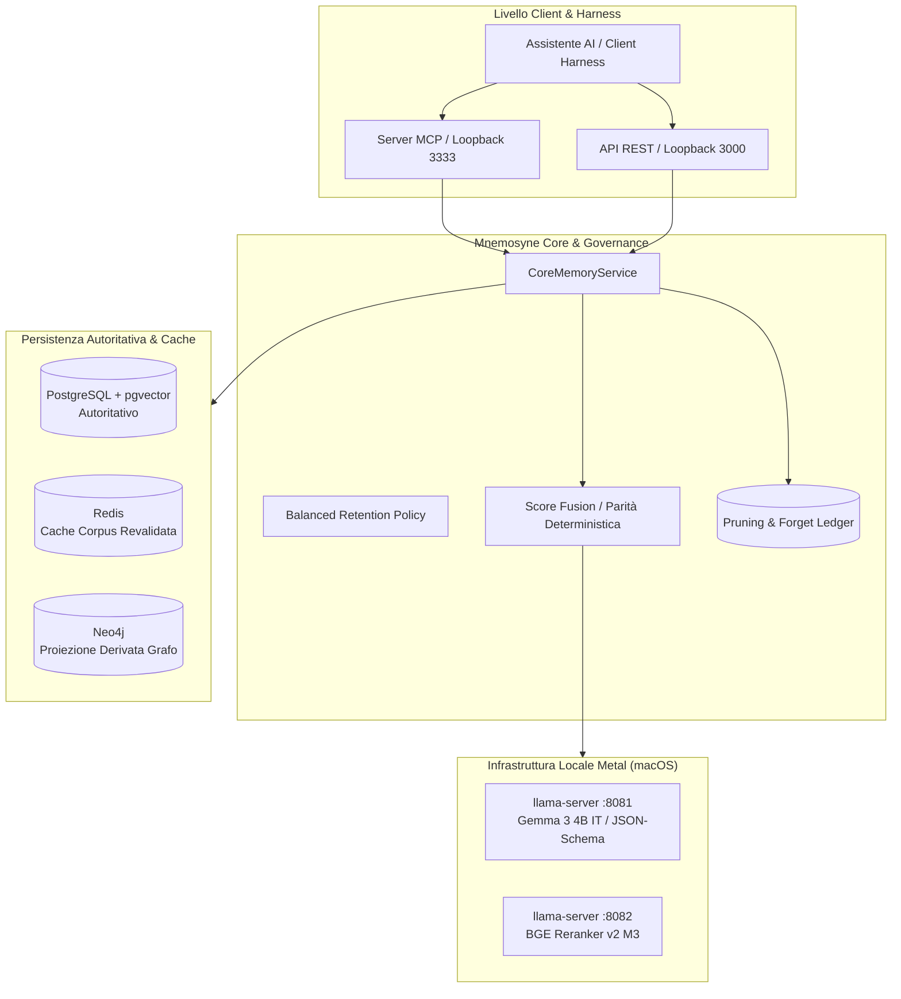
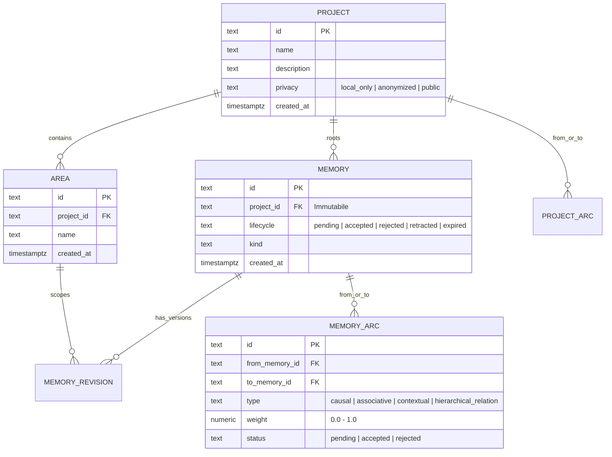
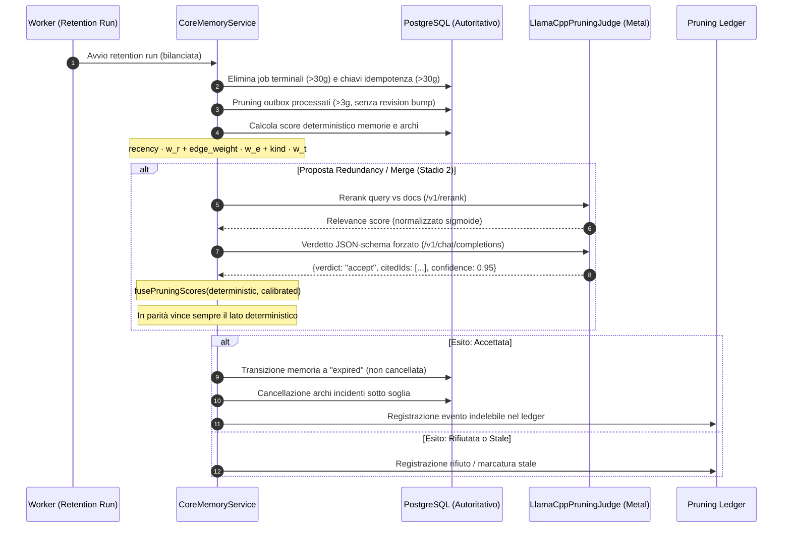

# Mnemosyne V2 — Documentazione Completa di Progetto e Architettura

> **Principio Cardine:** _«Il modello propone, il servizio decide»_.  
> Nessun modello linguistico modifica, cancella o valida mai direttamente i dati del corpus: il colpo di forbice finale, la policy di ammissione e l'audit indelebile appartengono sempre e soltanto al servizio deterministico.

---

## 1. Visione d'Insieme & Scelte Strategiche

Mnemosyne è un servizio di memoria semantica governata e persistente progettato per assistenti AI. Fornisce un contesto affidabile e continuo attraverso sessioni, progetti e aree di lavoro, prevenendo l'accumulo di rumore, allucinazioni e contrasti epistemici.



### 1.1 Decisione sulla Separazione dei Rami (Nessun Merge con `main`)

Per decisione esplicita e definitiva del proprietario:

- **`main`**: rimane dedicato al deployment di produzione esistente sul Mac mini (architettura v1 con scope derivati a stringa). È una versione provata e congelata.
- **`feat/v2-graph-model`**: è la versione indipendente di **Mnemosyne V2**, caratterizzata da un modello a grafo relazionale di primo livello, potatura semantica a due stadi accelerata su Metal e isolamento granulare della privacy.
- **Nessun merge verrà mai eseguito tra le due versioni**: le due linee rimangono permanentemente autonome.

---

## 2. Il Modello a Grafo Relazionale (V2)

In Mnemosyne V2, le relazioni e gli ambiti di memoria abbandonano le stringhe libere e diventano entità relazionali con integrità referenziale garantita da vincoli SQL.

### 2.1 Entità Fondamentali



1. **Progetti come Radici del Grafo (`projects`)**:
   - Tabella autoritativa con chiave primaria `id` (slug univoco).
   - `memories.project_id` e `sessions.project_id` sono Foreign Key reali e immutabili.
   - Il vecchio scope `global` è stato ritirato e sostituito dal progetto riservato `personal`, accessibile e visibile da qualunque sessione per policy, preservando il comportamento storico.
2. **Aree come Sottografi Opzionali (`areas`)**:
   - Tabella dedicata per partizionare la conoscenza interna di un progetto (es. `sviluppo`, `riunioni`, `cucina`).
   - Una memoria può opzionalmente fare riferimento a un'area solo se questa appartiene allo stesso progetto (garantito da vincolo e trigger SQL).
3. **Archi Governati (`memory_arcs` e `project_arcs`)**:
   - Collegano le memorie o i progetti con tipologia esplicita e peso `0.0 - 1.0`.
   - **Regola dei Cicli**: gli archi associativi, causali o contestuali possono formare cicli liberi (influenze reciproche); gli archi gerarchici (`hierarchical_relation`) impediscono cicli diretti tramite walk ricorsivo SQL in transazione protetta da lock advisory.
4. **Proiezione Neo4j Derivata**:
   - Neo4j non è mai autoritativo: è una proiezione read-only per visualizzazione e analisi.
   - Nodi `(:Project)`, `(:Area)`, `(:Memory)` e relazioni `[:IN_PROJECT]`, `[:IN_AREA]`, `[:PART_OF]`, `[:LINK]`.
5. **Dashboard Web su Canvas Nativo**:
   - Renderer Canvas nativo a 60 fps con cluster separati per scope, zoom, pan e highlighting persistente del nodo selezionato.
   - **Layer Progetti**: i nodi progetto vengono visualizzati solo se incidenti ad almeno un arco, evitando il sovraffollamento visivo in presenza di decine di progetti disconnessi.

---

## 3. Sistema di Potatura Semantica a Due Stadi

La potatura automatica previene il degrado e l'ingrossamento incontrollato del grafo informativo attraverso due stadi complementari.



### 3.1 Stadio 1: Job Deterministico & Retention Operativa

1. **Formula dello Score Deterministico**:
   $$\text{score} = w_r \cdot \text{recency} + w_e \cdot \text{avg\_edge\_weight} + w_t \cdot \text{kind\_factor}$$
   - Pesi predefiniti: $w_r = 0.5$, $w_e = 0.3$, $w_t = 0.2$.
   - Whitelist: `fact` e `decision` non decadono mai per disuso (possono essere solo superseded tramite correzione).
2. **Ciclo di Vita `expired`**:
   - Una memoria decaduta passa allo stato `expired`: esce dal contesto di retrieval (solo `accepted` viene letto dagli assistenti) ma rimane conservata nel database per audit.
3. **Potatura Archi Prima dei Nodi**:
   - Un arco sotto soglia di peso ($< 0.20$) viene potato anche se i due nodi collegati rimangono attivi.
4. **Pulizia Operativa**:
   - Job in stato terminale (`succeeded`, `failed`, `quarantined`, `cancelled` e rispettivi `job_attempts`): rimossi dopo **30 giorni**.
   - Chiavi di idempotenza scadute: rimosse dopo **30 giorni**.
   - Eventi outbox processati: rimossi dopo **3 giorni**.
   - _Tutte le rimozioni operative non incrementano la revisione del corpus_, evitando di invalidare le ricerche in cache.

### 3.2 Stadio 2: Giudice Calibrato (`LlamaCppPruningJudge`)

1. **Ridondanza Semantica tramite Reranking (`/v1/rerank`)**:
   - Utilizza un modello di cross-encoder (es. `bge-reranker-v2-m3`).
   - I logit restituiti (unbounded, da $-\infty$ a $+\infty$) vengono normalizzati tramite funzione sigmoide:
     $$S_{\text{norm}} = \frac{1}{1 + e^{-S_{\text{raw}}}}$$
   - Discrimina le ridondanze senza richiedere generazione di testo, con tempi di risposta di pochi millisecondi.
2. **Verdetti Vincolati tramite JSON-Schema (`/v1/chat/completions`)**:
   - Utilizza un modello compatto di istruzione (es. `gemma-3-4b-it`).
   - `llama-server` applica una grammatica vincolata a token-level (`judgeVerdictJsonSchema`), costringendo il modello a produrre unicamente JSON validi con la struttura:
     ```json
     {
       "verdict": "accept" | "reject",
       "citedIds": ["id_1", "id_2"],
       "confidence": 0.0 - 1.0,
       "reason": "Motivazione concisa..."
     }
     ```
   - **Rifiuto Allucinazioni**: il client scarta e rifiuta categoricamente qualunque verdetto che citi identificatori non presenti nel batch di input.
3. **Fusione Esplicita dei Punteggi (`fusePruningScores`)**:
   - Unisce la pressione deterministica con il verdetto calibrato.
   - **Regola di Parità Assoluta**: se il punteggio combinato è esattamente alla soglia, oppure se i due segnali discordano, **vince sempre il lato deterministico**.

### 3.3 Privacy & Batch Composition

I progetti e i nodi possiedono un flag privacy esplicito (mai dedotto in automatico):

- **`LOCAL_ONLY` (default)**: il dato non esce mai dalla macchina locale, escluso da qualunque batch LLM.
- **`ANONYMIZED`**: al modello esce solo un riassunto lossy (tipo di scope, fascia d'età, kind, archi incidenti), privo di testo grezzo o entità personali.
- **`PUBLIC`**: il contenuto può essere inviato per intero.
- I batch analizzati non mescolano mai nodi con flag privacy differenti.

---

## 4. Validazione Empirica — Risultati del Golden Set

Il sistema è stato collaudato dal vivo contro un dataset etichettato di **30 coppie di memorie in italiano** ([`scripts/pruning-golden-set.json`](file:///Users/spina/.gemini/antigravity/worktrees/Mnemosyne/implement_v2_graph_model/scripts/pruning-golden-set.json)) collegato a `llama-server` nativo con accelerazione Metal (Gemma 3 4B su porta 8081, BGE Reranker v2 M3 su porta 8082).

| Categoria di Prova                         |  Coppie  | Modello Esecutore           |       Risultato Live        | Accuratezza |
| :----------------------------------------- | :------: | :-------------------------- | :-------------------------: | :---------: |
| **Contraddizioni Dirette**                 |    6     | Detector Deterministico     |          **6 / 6**          |  **100%**   |
| **Compatibilità / Non-Contraddizione**     |    4     | Detector Deterministico     |          **4 / 4**          |  **100%**   |
| **Tie-Break di Parità a Soglia**           | Boundary | `fusePruningScores`         | **Vittoria Deterministica** |  **100%**   |
| **Proposte di Fusione (Merge)**            |    6     | Gemma 3 4B IT (JSON-Schema) |          **6 / 6**          |  **100%**   |
| **Sfumature Distinte (Scarto Ridondanza)** |    6     | BGE Reranker v2 M3          |          **6 / 6**          |  **100%**   |
| **Ridondanze Chiare (Cattura)**            |    8     | BGE Reranker v2 M3          |          **7 / 8**          |  **87.5%**  |
| **Totale Valutazioni Calibrate**           |  **20**  | **Pipeline Integrata**      |         **19 / 20**         |  **95.0%**  |
| **Errori HTTP o Parse JSON**               |    20    | Pipeline Integrata          |            **0**            |  **0.0%**   |

> [!NOTE]
> Il 95% di accuratezza con zero errori di sintassi dimostra che il vincolo grammaticale JSON-Schema di `llama.cpp` elimina completamente la fragilità del parsing, mentre la normalizzazione sigmoide sui logit permette al reranker di operare come discriminatore binario perfetto sulle sfumature non ridondanti.

---

## 5. Runbook Operativo per Apple Silicon (M-Series)

### 5.1 Prerequisiti & Dipendenze Host

```bash
# Installazione di llama.cpp nativo con Metal via Homebrew
brew install llama.cpp

# Verifica supporto Metal (Darwin arm64)
llama-server --version
```

### 5.2 Download dei Pesi GGUF

I pesi risiedono nella directory `~/.mnemosyne/models/`:

```bash
mkdir -p ~/.mnemosyne/models

# 1. BGE Reranker v2 M3 (multilingua, quantizzazione Q4_K_M, ~418 MB)
curl -L -C - -o ~/.mnemosyne/models/bge-reranker-v2-m3-Q4_K_M.gguf \
  "https://huggingface.co/gpustack/bge-reranker-v2-m3-GGUF/resolve/main/bge-reranker-v2-m3-Q4_K_M.gguf"

# 2. Gemma 3 4B Instruct (quantizzazione Q4_K_M, ~2.49 GB)
curl -L -C - -o ~/.mnemosyne/models/gemma-3-4b-it-Q4_K_M.gguf \
  "https://huggingface.co/bartowski/google_gemma-3-4b-it-GGUF/resolve/main/google_gemma-3-4b-it-Q4_K_M.gguf"
```

### 5.3 Avvio dei Demoni Locali `llama-server`

Per eseguire i test o avviare il backend del giudice in locale:

```bash
# Terminale 1: Gemma 3 4B IT su porta 8081 (verdetti vincolati)
/opt/homebrew/bin/llama-server \
  -m ~/.mnemosyne/models/gemma-3-4b-it-Q4_K_M.gguf \
  --port 8081 \
  --host 127.0.0.1 \
  --ctx-size 2048 \
  --n-gpu-layers 99 \
  --alias gemma-3-4b-it

# Terminale 2: BGE Reranker su porta 8082 (endpoint /v1/rerank)
/opt/homebrew/bin/llama-server \
  -m ~/.mnemosyne/models/bge-reranker-v2-m3-Q4_K_M.gguf \
  --port 8082 \
  --host 127.0.0.1 \
  --reranking \
  --n-gpu-layers 99 \
  --alias bge-reranker
```

### 5.4 Esecuzione del Probing Test

```bash
PRUNING_JUDGE_ENABLED=true \
PRUNING_JUDGE_BASE_URL=http://127.0.0.1:8081/v1 \
PRUNING_JUDGE_RERANK_BASE_URL=http://127.0.0.1:8082/v1 \
PRUNING_JUDGE_RERANK_MODEL=bge-reranker \
PRUNING_JUDGE_INSTRUCT_MODEL=gemma-3-4b-it \
node scripts/probe-judge.mjs
```

### 5.5 Gestione Tramite macOS `launchd`

Il template per avviare il servizio all'accesso utente si trova in [`ops/host/launchd/com.mnemosyne.llama.plist`](file:///Users/spina/.gemini/antigravity/worktrees/Mnemosyne/implement_v2_graph_model/ops/host/launchd/com.mnemosyne.llama.plist).

---

## 6. I Tre Gate Obbligatori di Conformità

Prima di considerare qualunque modifica conclusa su `feat/v2-graph-model`, i tre gate vanno eseguiti nel seguente ordine rigoroso:

1. **Gate 1 — Unit, Build & Format (`npm run verify`)**:
   - Esegue la compilazione TypeScript (`tsc --build`), il linter, Prettier e tutti i test Vitest unitari.
   - _Stato attuale_: **262 passati, 1 skipped (263 totali)**.
2. **Gate 2 — Test End-to-End Sintetico (`npm run e2e:synthetic`)**:
   - Crea container usa-e-getta di PostgreSQL e Neo4j, esegue il flusso completo a 3 memorie (inclusa area-scoped), esportazione/ripristino con preservazione dei nomi, asserzioni SQL sui vincoli e polling sul grafo live di Neo4j.
   - _Stato attuale_: **OK**.
3. **Gate 3 — Valutazione di Governance e Retrieval (`npm run eval:all`)**:
   - `eval-governance.mjs`: 9 scenari di governance, assenza di leak di contesto pending, rilevamento conflitti e merge duplicati (**9/9 passati**).
   - `eval-retrieval.mjs`: 11 query con giudizi umani, nDCG@K pari a 1.0 e latenza p50 < 0.5 ms (**11/11 passati**, hash `fe1369c0cd5e`).

---

## 7. Struttura dei Repository e Stato Git

- **Repository Remoto:** `https://github.com/TheKingSpina/mnemosyne.git`
- **Branch di Riferimento:** `feat/v2-graph-model` (tracciato su `origin/feat/v2-graph-model`).
- **Working Tree:** completamente pulita, zero modifiche uncommitted.
- **Commit di Riferimento Recenti:**
  - `dc7cce0`: Potatura automatica job terminali e chiavi idempotenza scadute.
  - `bcda2bf`: Giudice `LlamaCppPruningJudge` e fusione deterministica `fusePruningScores`.
  - `a8709a9`: Golden set 30 coppie, probing harness e template `launchd` Metal.
  - `9634ecc`: Normalizzazione logit sigmoide e supporto `rerankBaseUrl`.
  - `1b70541`: Formalizzazione della separazione permanente da `main` e pulizia design.
